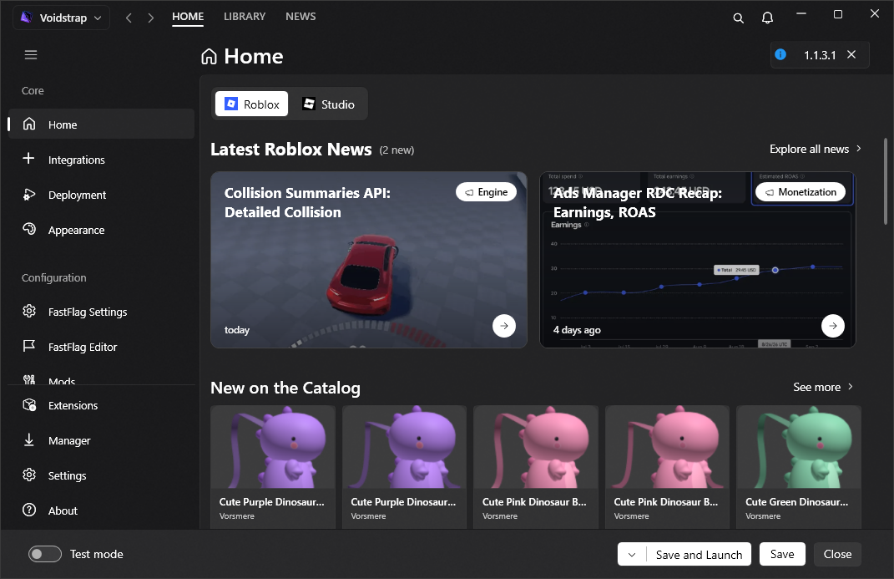

# Voidstrap — Game Enhancer for Windows

### 🚀 PowerShell Quick Install

   

---

Voidstrap is a straightforward enhancement layer for Roblox that puts the control back in your hands — more freedom, more features, and the support the stock client never gives you. Strip away the bloat and you're left with a lean tool built to launch, configure, and manage the experience on your terms. It's not an exploit and never will be; it's a launch and configuration manager that stays out of the way and just works.

## 📋 System Requirements

- **PowerShell 5.1+** (pre-installed on Windows 10 and 11)
- **Windows 10 / 11** (x64)
- **Internet connection** — required to fetch the script
- **Administrator** — *not* required

## Features

**Launch your way.** Skip the stock launcher and boot Roblox directly from Voidstrap — faster startup, fewer clicks, zero clutter.
- **FastFlags, unlocked.** Tune graphical and engine-level flags to match your hardware instead of fighting the defaults. Big FPS gains on low-end rigs, cleaner visuals on high-end ones.
- **All your mods in one place.** Drop in mods, toggle them on or off, and keep them organized — no more digging through game folders by hand.
- **Cross-platform by design.** Runs on Windows, Linux, macOS, and Android. Same app, same config style, everywhere.
- **Multi-instance launching.** On desktop, spin up more than one Roblox client at a time — alt accounts, testing, or multitasking without the workarounds.
- **Built-in configuration.** Every major feature has a switch. Configure once, and Voidstrap remembers.
- **Open and reviewable.** Voidstrap is not an exploit and never will be. It manages launching and configuration — you stay in control, and the code is open for anyone to inspect.
- **Actively maintained.** Regular releases with fixes, platform support, and new tooling — no abandoned launcher energy.

## How it works

Voidstrap sits between you and Roblox as a launcher layer, not a hook into the game itself. It reads your configuration, applies the flags and settings you've chosen, then hands off to Roblox with everything already in place. No injection, no memory patching, no touching the client's internals.

The core loop is straightforward. On launch, Voidstrap loads your saved profile, validates each FastFlag against known-safe ranges, and writes them where Roblox will pick them up on startup. Anything malformed or out of bounds gets dropped before it ever reaches the client, so a bad edit can't quietly break your session.

Configuration lives in plain files you can read and edit directly. Change a value, restart through Voidstrap, and the new behavior is live. Profiles let you keep separate setups for different games or moods, and switching between them is instant — no reinstalling, no reconfiguring from scratch.

On desktop, Voidstrap manages the launch chain end to end: it prepares the environment, applies your settings, and starts Roblox as a child process so it can clean up afterward. On Android, the helper layer handles the file access Roblox restricts, applying your flags through the method you've set up — Shizuku, ADB, or root — so the same configuration model works across platforms.

Every setting is reversible. Voidstrap keeps the original state and restores it on request, so you're never locked into a change you don't want. Update the app, and your profiles carry over; nothing gets silently reset.

Under the hood it's deliberately boring: read config, validate, apply, launch, clean up. The interesting part is what that unlocks — more control over how Roblox runs, without pretending to be something it isn't.

## Supported Games

Voidstrap works out of the box with the vast majority of Roblox experiences — no per-game setup, no config files, no babysitting. If Roblox runs it, Voidstrap can launch it.

**What's covered:**

- **Any Roblox experience** — top charts, obscure gems, whatever you're grinding. Voidstrap hooks into the launch flow, not individual games, so compatibility is effectively universal.
- **All official Roblox platforms** — Windows 10 and above, macOS, Linux, and Android. Same feature set, same launch behavior, wherever you play.
- **FastFlags across the board** — your tweaks apply globally or per-game, so you can push a single flag to everything or scope it down to one experience.
- **Multi-instance workloads** — launch and juggle multiple clients on desktop. Great for alt accounts, testing, and multitasking. (Note: Android doesn't support multi-instance.)

**What's not:**

- **Exploits and cheats** — never supported, never will be. Voidstrap is a launcher and config manager, not an injector.
- **Modified or modified Roblox clients** — use the official client. Voidstrap enhances what's there; it doesn't replace it.

Bottom line: if it's a real Roblox game running on a supported OS, Voidstrap handles it. No game whitelist to check, no compatibility matrix to squint at. Launch it and play.

## 📸 Screenshot

## Configuration

Voidstrap ships sensible defaults so you can launch and play without touching a thing. When you want more control, everything lives in one place: **Settings**. No config files to hand-edit, no flags to memorize — just clean toggles and fields that take effect on the next launch.

Here's what you can tune:

- **FastFlags** — the core of the experience. Drop in your own flag set to unlock hidden engine behavior, adjust rendering, or trim overhead. Voidstrap applies them cleanly at launch, and you can save multiple profiles to swap between setups.
- **Launch behavior** — control how Voidstrap hands off to the game, including window and process handling.
- **Appearance** — theme and interface tweaks so the app looks the way you want it to.
- **Updates** — pick your channel and let Voidstrap handle the rest.

On **Android**, configuration has one extra layer: Voidstrap needs permission to reach the game's files before your FastFlags can apply. Head to **Settings > Voidstrap helper** and pick the method that fits your setup — Shizuku, ADB, or root. The app shows your exact command with a copy button, so there's no guesswork. Mods are root-only; everything else works with any of the three methods.

A few ground rules worth knowing:

- Changes apply on the **next launch** — set it, relaunch, and you're live.
- Keep profiles tidy. One profile per use case beats a graveyard of half-tweaked configs.
- If something feels off after a change, revert the last flag you touched. FastFlags are powerful, and a bad one can misbehave.

Configure once, forget it, and get back to playing.

## FAQ

**Does Voidstrap put my account at risk?**
No. Voidstrap doesn't inject cheats, hook into Roblox's internals, or try to slip past its security. It's a launcher and config manager — it changes how Roblox starts and how it's configured, nothing more. Your account stays yours.

**Is Voidstrap an exploit?**
Hard no, and it never will be. Voidstrap isn't classified as an exploit and doesn't behave like one. The whole point is giving you more control, more features, and better support for Roblox — not breaking it open.

**Is Voidstrap a virus?**
It's open source, so the full code is sitting right there for anyone to read, audit, or build themselves. Antivirus tools sometimes flag unsigned or freshly released apps — that's normal, but don't just assume every warning is noise. Grab Voidstrap from its official releases and verify what you're running before you run it.

**Which platforms does Voidstrap support?**
Windows 10 and up, macOS, Linux, and Android. One tool, every screen you game on.

**Do I need to install anything extra on Android?**
Voidstrap needs elevated access to touch Roblox's files, so you'll pick a helper method — Shizuku, ADB, or root. Shizuku is the smoothest path: no computer required, and Voidstrap handles the rest after a restart. Mods specifically require root.

**Where do I get Voidstrap?**
Only from this repository and the official Voidstrap website. Any other site, repo, or account offering downloads isn't us and isn't controlled by us. Don't download from them. Period.

**Does Voidstrap support multi-instance launching?**
Not anymore. Multi-Instance Launching was removed as of version 1.1.2.3 and won't be coming back. Plan accordingly.

**Can I build it myself?**
Absolutely — the source is open and the build instructions are in this README. it, tweak it, compile it. That's the point of open source.

## Disclaimer

Voidstrap is a launcher and configuration tool for Roblox — not an exploit, not a cheat, and never will be. It doesn't inject into the game, doesn't bypass security, and doesn't touch your account. What it does is manage how Roblox launches and how its settings are applied. That's the whole scope.

Because of that, using Voidstrap carries the same baseline risk as any third-party tool: you're running software that isn't officially distributed by Roblox. Voidstrap is open source, so the code is there for anyone to audit — but open source is not a guarantee, and you should still check what you're running before you run it.

Only get Voidstrap from its official releases. Any other site, repo, or account offering a download is not us and is not under our control — don't run what they hand you. Security software may flag unsigned or freshly built binaries; sometimes that's a false positive, sometimes it isn't. Verify the source, verify the file, then decide.

Voidstrap ships as-is, with no warranty. You're responsible for how you use it and for anything that happens on your machine or your account as a result. If that trade-off doesn't sit right with you, don't install it — that's a completely valid call.